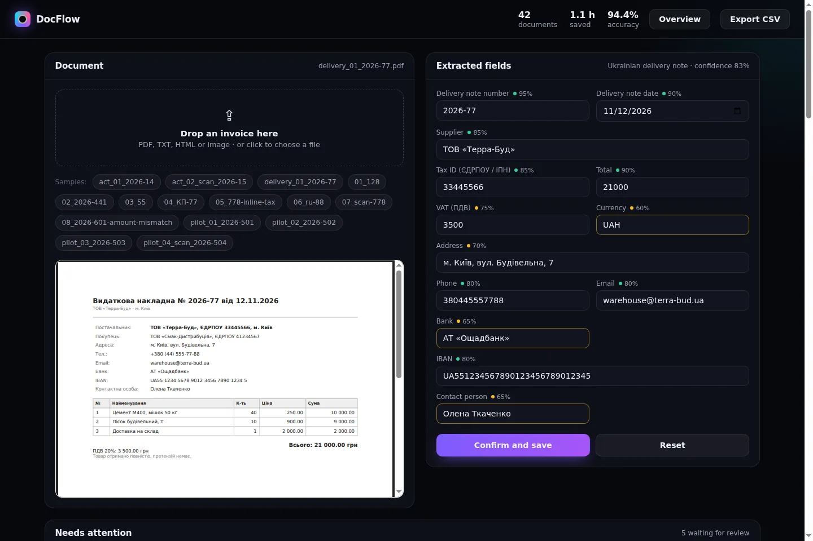

# DocFlow

**Every document → recognised fields → human review → routed to the process that owns them → a CRM deal.**

DocFlow is a working prototype of a document-intake platform: it takes a PDF, a scan
or an e-mail attachment, reads the whole document, shows what it is unsure about,
lets a human confirm it in one screen, and then sends the result where it belongs —
payments, accounting or approval — creating or updating a deal in the CRM.

The service is built to be market-neutral. A **document profile** carries everything
that belongs to one market — field labels, default currency, OCR language, tax-ID and
IBAN formats, legal forms for CRM matching. Two profiles ship today, the first ones
implemented: a Ukrainian invoice and a Ukrainian act of completed work. Adding a
document type or a second market means adding a profile, not rewriting the parser.




## What it does

- **Intake from several sources**: upload in the browser, sample documents, a watched
  `data/inbox/` folder, or an IMAP mailbox (`mailbox.py`).
- **Whole-document recognition**: a profile registry decides the document type from the
  first lines, the profile extracts fields with per-field confidence and supplies the
  labels the reviewer sees; `pdftotext` first, OCR as a fallback for scans (the language
  set comes from the registered profiles, `DOCFLOW_OCR_LANGS` overrides it).
- **Uncertainty is visible, not hidden**: confidence dots in the review form, deterministic
  invariants (amount = items sum, tax ID format, IBAN, phone, e-mail), and an exception
  queue for documents that need attention.
- **Deterministic routing**: invoice → Payments, act → Accounting, any document above
  `DOCFLOW_APPROVAL_THRESHOLD` (default 100 000) → Approval. The destination and its
  reason are stored with the record, shown in the result card and added to the CRM comment.
- **One CRM interface, two connectors**: Uspacy (verified against a live account) and
  Bitrix24 (incoming webhook, verified against a local fake of the REST protocol).
- **Duplicate protection** on two levels: local history (number + supplier + date) and a
  client-side match against the CRM.
- **History, impact report and CSV export**: auto-pass rate, median review time, saved
  minutes, top manual corrections and tripped invariants.

## How it works

```text
browser / folder / mailbox
        │
        ▼
   app.py  ── text ──► extractor.py ──► profiles/ (invoice_ua, act_ua)
        │                              │
        │                              └── validation.py  (deterministic invariants)
        ├── data/pending/<id>.json  ──► review UI  ──► data/confirmed.jsonl
        └── routing.py ──► connectors/ (Uspacy, Bitrix24)
```

The showcase page (`/`) explains the flow; the review workspace (`/app`) is where
documents are confirmed.

## Quick start

```bash
python3 -m venv .venv && . .venv/bin/activate
pip install -r requirements.txt
cp .env.example .env    # optional: everything has a safe default
./dev.sh start
```

- overview → <http://127.0.0.1:8765/>
- workspace → <http://127.0.0.1:8765/app>

`dev.sh` reads `.env` and runs the FastAPI app with uvicorn; `./dev.sh status`,
`./dev.sh logs`, `./dev.sh restart` are available too.

Docker:

```bash
docker build -t docflow .
docker run --rm -p 8000:8000 --env-file .env -v "$PWD/data:/app/data" docflow
```

## Configuration

Everything is optional; the application starts with no CRM and no mailbox.

| Variable | Meaning |
| --- | --- |
| `HOST` / `PORT` | bind address (default `0.0.0.0:8765`) |
| `DOCFLOW_DEMO_MODE` | `1` — Confirm returns a simulated deal, the CRM is never called |
| `DOCFLOW_CRM` | `uspacy`, `bitrix24` or `none` |
| `USPACY_BASE_URL`, `USPACY_EMAIL`, `USPACY_PASSWORD` | Uspacy account |
| `BITRIX24_WEBHOOK_URL` | incoming webhook of a Bitrix24 portal |
| `DOCFLOW_APPROVAL_THRESHOLD` | amount above which a document goes to approval |
| `DOCFLOW_MANUAL_MINUTES` | manual-entry minutes used by the impact report |
| `DOCFLOW_IMAP_HOST`, `_PORT`, `_USER`, `_PASSWORD`, `_FOLDER`, `_INTERVAL`, `_SSL` | mailbox intake; empty host/user/password disables it |
| `DOCFLOW_OCR_LANGS` | OCR languages, e.g. `ukr+eng`; default is the union of the registered profiles |

Secrets live only in `.env` (git-ignored). `.env.example` documents the keys with empty values.

## Verification

The deterministic suite runs without network, credentials or a real CRM:

```bash
python3 tests/run_eval.py            # 12 labelled fixtures, 97/97 checks, 0 confident errors
python3 tests/run_eval_split.py      # real vs synthetic split
for suite in tests/test_*.py; do python3 "$suite" || exit 1; done
```

`tests/test_*.py` covers duplicate suppression, impact maths, CRM matching and company
mapping, the review queue, document-type detection, routing rules, roadmap data, the
connector layer (Bitrix24 over a local fake HTTP server) and mailbox intake (MIME parsing,
retries, dedupe, login errors — over a local fake IMAP server). CI runs the same suites
plus a Docker build on manual dispatch and on pull requests.

## Design principles

1. Separate probabilistic interpretation (reading a document) from deterministic execution
   (validating, routing, writing to the CRM).
2. Keep whole-document context: line-by-line parsing produces confident errors.
3. A confident error is worse than a missing value — never silently send a wrong amount,
   supplier, tax ID or currency to the CRM.
4. Preserve uncertainty: human review is expected, not a failure.
5. Fix defect classes, not single examples: root cause → invariant → test → fix → regression.
6. Prefer deterministic code for formal rules; new document types extend the profile
   registry instead of growing one regex pile.

## Status and limits

This is a prototype for a client demonstration, not a production platform:

- two document profiles are implemented (Ukrainian invoice and act); other markets need a
  profile each, and the review form is one fixed field set rather than profile-specific;
- one business workspace and one configured mailbox/CRM at a time; there are no accounts,
  roles or audit yet;
- the app has no authentication of its own and is published to a private tailnet only;
- Bitrix24 works against a local fake of the REST protocol; a live portal check is pending;
- Uspacy attachment upload and a payment task are not available in the test tenant API;
- routing rules by supplier and several recipients per document are not implemented yet.

## Roadmap and documentation

- Product path: [`docs/roadmap.json`](docs/roadmap.json) (rendered as “Our path” on the site).
- Plain-language guide (Russian): [`docs/plain-guide.md`](docs/plain-guide.md).
- Architecture: [`docs/architecture.md`](docs/architecture.md) · process map:
  [`docs/process-map.md`](docs/process-map.md) · operations and publishing:
  [`docs/stack-and-operations.md`](docs/stack-and-operations.md).
- Working state and next steps (Russian): [`memory/handoff.md`](memory/handoff.md).

## Repository layout

```text
app.py             FastAPI orchestration, persistence, review workflow, reporting
extractor.py       text acquisition, OCR fallback, field interpretation
profiles/          document-type profiles and the detection registry
connectors/        CRM connectors behind one interface (Uspacy, Bitrix24)
routing.py         deterministic destination policy
validation.py      deterministic field invariants
uspacy*.py         Uspacy authentication, client-side matching, deal creation
templates/         showcase page (/) and review workspace (/app)
tests/             deterministic suites and labelled fixtures
docs/              architecture, process map, roadmap, plain guide
memory/            working memory: state, handoff, decision log, plain log
```

---

**По-русски, коротко:** DocFlow — прототип платформы для автоматизации документооборота:
документы приходят из папки или почты, распознаются, проходят проверку человеком и уходят
в нужный процесс и CRM. Сервис задуман универсальным: всё, что относится к конкретному
рынку, живёт в профиле документа, а не в ядре; сейчас реализованы украинские счёт и акт.
Подробное объяснение простым языком — [`docs/plain-guide.md`](docs/plain-guide.md),
рабочее состояние — [`memory/handoff.md`](memory/handoff.md).
