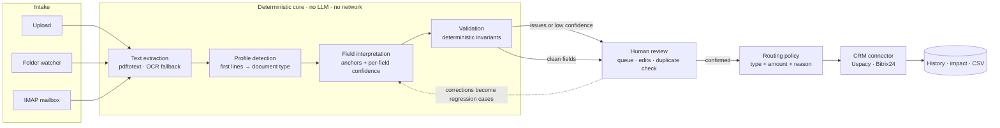

# DocFlow

**Document intake for B2B teams: a deterministic pipeline from a file or a mailbox to a reviewed CRM deal.**

DocFlow takes a PDF, a scan or an e-mail attachment, works out what kind of document
it is, reads the whole document, shows the human what it is unsure about, lets them
confirm it on one screen, and sends the result to the process that owns it — payments,
accounting or approval — creating or updating a deal in the CRM.

The core is deterministic on purpose: formal rules are code, the document is read
through a **profile** (a data description of a document type and its market), and the
only probabilistic step — deciding what a human still needs to check — is surfaced in
the review queue instead of being hidden behind a model. No LLM orchestrator sits in
the decision path; that is a design choice, explained below.


## What it does

- **Intake from several sources**: browser upload, sample documents, a watched
  `data/inbox/` folder, or an IMAP mailbox.
- **Whole-document recognition**: the first lines decide the document type through a
  profile registry (invoice, act of completed work, delivery note); the profile supplies
  the anchors, value formats and field labels the reviewer sees. `pdftotext` first, OCR
  only as a fallback for scans.
- **Deterministic validation**: amount = sum of items, VAT ≈ 20/120 of the total, tax-ID
  and IBAN formats, phone/e-mail shape. A failed invariant lowers confidence and puts the
  document in front of a human — it never "fixes" a value silently.
- **Deterministic routing**: invoice → Payments, act and delivery note → Accounting, any
  document above `DOCFLOW_APPROVAL_THRESHOLD` (default 100 000) → Approval. The
  destination and its reason are stored with the record and written into the CRM comment.
- **One CRM interface, two connectors**: Uspacy (verified against a live account) and
  Bitrix24 (incoming webhook, verified against a local fake of the REST protocol).
- **Duplicate protection on two levels**: local history (number + supplier + date) and a
  client-side match against the CRM.
- **History, impact report and CSV export**: auto-pass rate, review time, saved minutes,
  top manual corrections and tripped invariants. The headline numbers on the page and the
  report are the same numbers: one function computes them, and the accuracy denominator is
  the field count of the document profile, not a constant typed into a screen.
- **Review time is a session, not a wait.** The clock starts when a person opens the
  document and stops when they confirm it. Measuring upload → confirmation counted the
  queue, so a document confirmed a week later reported a week of review; a document nobody
  opened now reports nothing, and the report says how many sessions it is based on.

## Architecture



The pipeline is fixed and testable: every stage has one responsibility and one output
shape, so a defect belongs to exactly one stage. The human is a stage, not an exception
handler: the review form shows per-field confidence and tripped invariants, and the
confirmation is the only moment a document can reach the CRM.

### What makes it serve more than one company at a time

Four pieces, each answering a question that only appears when the second customer arrives:

| Piece | The question it answers | Where |
| --- | --- | --- |
| Connection pool with a transaction-local tenant | Can one process serve many companies without handing one's rows to another? | `db.py` |
| Durable job queue with `FOR UPDATE SKIP LOCKED` | What happens to slow, flaky work when there are two workers, or when one dies mid-job? | `jobqueue.py`, `worker.py`, `sql/006_jobs.sql` |
| Metrics | Is the queue backed up, is the pool exhausted, who is actually using it? | `metrics.py`, `/api/metrics` |
| Migrations with a version table | Is this database at the same version as the code, and did the last deploy really finish? | `tools/migrate.py`, `schema_migrations` |

The queue replaces a JSONL file with a lock in one process: two workers overwrote each
other, a restart lost the attempt count, and "how much is stuck" was answered by opening a
file. The pool replaces a connection per query, and the tenant is set with `SET LOCAL` so it
cannot survive into the next request on a reused connection — `tests/test_db.py` runs both
tenants through one pooled connection and checks that the second sees nothing.

## Why this pipeline

- **Interpretation is separated from execution.** Reading a document is a judgement;
  validating, routing and writing to the CRM is arithmetic and rules. Mixing them makes
  both untestable.
- **The whole document is the context.** Line-by-line parsing produces confident errors:
  a number that looks like a total on its own line is usually a subtotal.
- **A confident error is worse than a gap.** A missing amount sends a document to a human;
  a wrong amount silently closes the wrong deal. The pipeline is built to prefer the first.
- **No LLM orchestrator by design.** An agent graph in the hot path would add cost,
  latency, non-reproducible outputs and a second source of confident errors, while the
  documents that actually need interpretation are already covered by profiles and a human.
  If a model is ever added, it is a fallback that proposes a value into the same review —
  never a stage that decides on its own.
- **A new document type is data, not a branch.** Profiles carry anchors, totals wording,
  value formats and labels; the parser and the CRM connectors stay unchanged. Three types
  ship today: a Ukrainian invoice, an act of completed work and a delivery note.

## Handling dirty data

The interesting engineering is not the happy path. These are the failure classes the
system is built around, and the test that keeps each one fixed.

| What goes wrong | What the system does | Proof |
| --- | --- | --- |
| OCR reads «ІПН» as «INH», «ЄДРПОУ» as «ЕДРПОУ», «№» as «N/Mo/Ne» | The profile knows OCR look-alikes in its tax-ID and number anchors; the document is read as a whole, not per line | OCR-noise fixtures in `tests/run_eval.py` |
| A scan has no text layer | Text extraction falls back to OCR with the language set of the registered profiles; nothing is guessed from the filename | `tests/run_eval.py` plus a verified image-only sample |
| Items do not add up to the total, or VAT ≠ 20/120 | The invariant fails, the confidence of the total and VAT is halved, the document is flagged with issues and waits for a human | `tests/run_eval.py` — 104 checks, 0 confident errors |
| Tax ID, IBAN, phone or e-mail is malformed | The field is marked low-confidence and reported as an issue; no value is ever silently corrected | `tests/run_eval.py`, `validation.py` |
| The same invoice arrives twice | Local history is checked first (number + supplier + date), then the CRM is matched on the client; the second confirmation returns the existing deal instead of creating a new one | `tests/test_dedupe.py` |
| The CRM ignores `search`/`filter`/`limit` and returns a page anyway | The connector reads pages and matches on the client; a `200` answer is never trusted as proof that a filter was applied | `tests/test_uspacy_match.py` |
| An old cached form posts fewer fields than the document has | Missing keys are merged back from the parsed result on the server; pages are served with `Cache-Control: no-store` | `tests/test_crm_enrichment.py` |
| Mail crashes after an attachment was ingested | The message is marked as seen only after a successful ingest; on failure it stays unseen and is retried | `tests/test_mailbox.py` |
| A file is still being copied when the watcher sees it | Files younger than two seconds are skipped, handled files are moved aside so a restart does not process them twice | `tests/test_inbox.py` |
| The CRM is unreachable | Confirmation reports `company_error` / `contact_error` instead of pretending success; failed deals go to a retry queue | `tests/test_crm_enrichment.py` |
| Someone asks for a file by a path instead of an id | The id is checked against the two shapes the service issues, and the file name is built from known extensions instead of a pattern | `tests/test_security.py` |
| An invoice names its supplier `<script>…` | Every value that reaches a page goes through one escaping helper, values inside attributes included; the file stays hostile input, not trusted markup | `tests/test_security.py` |
| Two clicks land on Confirm at the same moment | In the file store the duplicate check and the write share one lock, so the second click is answered as a duplicate; in PostgreSQL the unique index decides | `tests/test_security.py` |

## Stack and engineering approach

| Piece | Choice | Why |
| --- | --- | --- |
| Runtime | Python 3.12 + FastAPI, one process | small surface, easy to run and to review; a prototype should not need a cluster |
| Persistence | JSONL history + JSON snapshots | append-only audit trail, no migration ceremony, trivially inspectable |
| UI | plain HTML/CSS/JS | no build step; the reviewer sees exactly the data the server returns |
| Documents | `pdftotext`, `pypdf`, portable Tesseract OCR | text first, OCR only as fallback |
| CRM | one connector interface, two adapters | the review flow is vendor-neutral; swapping the CRM is configuration |
| Tests | deterministic suites, no network | the same document always produces the same verdict, so regressions are visible |

Document processing is sequential per document and takes no network decision, so the same
input produces the same verdict; the application is asynchronous only where it waits (the
folder watcher and the IMAP poll run in the background). What used to be a race is now an
explicit rule rather than a hope: the file store checks the history and appends under one
lock, PostgreSQL lets a partial unique index decide what a duplicate is, and slow or flaky
work — a CRM call that timed out — goes to the database queue instead of a thread next to
the request, where the worker drains it with `FOR UPDATE SKIP LOCKED`. There is **no
orchestration framework** (no LangGraph, no CrewAI) and no multi-agent graph: the pipeline
is a fixed sequence of deterministic stages with one human checkpoint, which is what makes
the failure classes above testable.

## Seeing it work

The workspace is one screen: the document on the left, extracted fields with per-field
confidence on the right, and the review queue below it.


Run it locally in three commands:

```bash
python3 -m venv .venv && . .venv/bin/activate
pip install -r requirements.txt
./dev.sh start
```

- overview → <http://127.0.0.1:8765/>
- workspace → <http://127.0.0.1:8765/app>
- metrics → <http://127.0.0.1:8765/api/metrics> (or `?format=prometheus`)

Docker:

```bash
docker build -t docflow .
docker run --rm -p 8000:8000 --env-file .env -v "$PWD/data:/app/data" docflow
```

## Configuration

Everything is optional; the application starts with no CRM and no mailbox.

| Variable | Meaning |
| --- | --- |
| `HOST` / `PORT` | bind address (default `0.0.0.0:8765`) |
| `DOCFLOW_DEMO_MODE` | `1` — Confirm returns a simulated deal, the CRM is never called |
| `DOCFLOW_CRM` | `uspacy`, `bitrix24` or `none` |
| `USPACY_BASE_URL`, `USPACY_EMAIL`, `USPACY_PASSWORD` | Uspacy account |
| `BITRIX24_WEBHOOK_URL` | incoming webhook of a Bitrix24 portal |
| `DOCFLOW_APPROVAL_THRESHOLD` | amount above which a document goes to approval |
| `DOCFLOW_MANUAL_MINUTES` | manual-entry minutes used by the impact report |
| `DOCFLOW_IMAP_HOST`, `_PORT`, `_USER`, `_PASSWORD`, `_FOLDER`, `_INTERVAL`, `_SSL` | mailbox intake; empty host/user/password disables it |
| `DOCFLOW_OCR_LANGS` | OCR languages, e.g. `ukr+eng`; default is the union of the registered profiles |
| `DOCFLOW_ASSISTANT_URL` | optional URL of an assistant widget script shown on the pages; empty disables it |
| `DOCFLOW_MAX_UPLOAD_MB` | upload size limit, enforced while the body is streaming (default 20) |
| `DOCFLOW_MAX_PDF_PAGES` | page limit for one PDF (default 200); a page count is a cost bound, not a validity rule |
| `DOCFLOW_PG_POOL_MIN` / `DOCFLOW_PG_POOL_MAX` | connection pool size (default 1…8); one connection serves many requests |
| `DOCFLOW_JOBS` | `off` disables the in-process background worker (the queue is then drained by `python3 -m worker`) |
| `DOCFLOW_DEFAULT_COMPANY` | the company a file-demo retry belongs to (default 1); a multi-company deployment passes the tenant with the job |

Secrets live only in `.env` (git-ignored). `.env.example` documents the keys with empty values.

## Verification

The deterministic suite runs without network, credentials or a real CRM:

```bash
python3 tests/run_eval.py            # 13 labelled fixtures, 104/104 checks, 0 confident errors
python3 tests/run_eval_split.py      # real vs synthetic split
pytest -q --cov --cov-fail-under=70  # the whole suite in one process, with the coverage gate
ruff check .                         # the lint CI runs (pip install -r requirements-dev.txt)
```

`tests/test_*.py` covers duplicate suppression, impact maths, CRM matching and company
mapping, the review queue, document-type detection, routing rules, roadmap data, the
connector layer (Bitrix24 over a local fake HTTP server), mailbox intake (MIME parsing,
retries, dedupe, login errors — over a local fake IMAP server), tenancy, sign-in, upload
limits, the request log, the pool (two tenants on one connection), the queue (six workers
claiming at once), the migration runner, the signed-in lifecycle (upload → row → confirm →
history → export, and a stranger seeing none of it) and the two ways a demo becomes an
incident: a request that becomes a path and a document that becomes markup. CI runs the same
suites with the coverage gate, the lint, and a Docker build on every push to `main`, on
pull requests and on manual dispatch.

What the number means, because it is easy to read it as more than it is: 104 checks over 13
fixtures is a regression baseline, not evidence of generalisation. The fixtures were used
while the parser was being written, so the score says "nothing that worked broke", not "this
reads any invoice". Measuring on documents the parser has never seen is the honest next step
and is not done yet.

The tenancy and sign-in suites need a database; in a CI run without one they skip instead of
failing. The workflow starts PostgreSQL, applies `sql/` and connects as a role without
`SUPERUSER` or `BYPASSRLS`, because the policies are enforced against a role that cannot
ignore them — a superuser would make the test pass without testing anything.

## Data model in PostgreSQL

### Where a document lives

Two contours exist on purpose, and the line between them is stated here rather than left to
be discovered:

There is one lifecycle, and it runs through the database. Signed in, an upload creates the
`documents` row (supplier, parsed snapshot, per-field confidence, the file it came from),
the review queue reads that row, the confirm finishes it — status, confirmed values, the
deal and the audit event, in one transaction — and the history, the impact report, the CSV
and the preview all read the same row. `pg_documents.py` is that path.

| | Signed in | Signed out |
| --- | --- | --- |
| Where a document lives | the `documents` row, from upload to history | `data/pending/*.json` and `data/confirmed.jsonl` |
| Isolation | row-level security per company | one deployment, one workspace |
| Sign-in | password or Google, session in the database | none |
| Why it exists | the product | a demonstration on a machine with no database |

The file store is not a second product and not a parallel contour: it is the standalone mode,
and both modes return the same shapes, which is why the interface never learns where a row
came from. `tests/test_lifecycle.py` drives the signed-in path end to end — upload, queue,
preview, confirm, history, impact, export, another company seeing nothing — and checks the
signed-out upload stays a file with no database row.

```text
sql/001_schema.sql          suppliers, supplier_contacts, documents, document_items,
                            deals, document_events
sql/002_service_tables.sql  settings: named values with an explicit type
sql/003_multi_tenant.sql    companies, users and the row-level isolation policy
sql/004_roles_and_company_settings.sql  a read-only role, a company override of a
                            platform setting, and the lookup that resolves them
sql/005_auth.sql            users' password hash and Google subject, sessions, auth events
sql/006_jobs.sql            the durable queue: queued work, attempts, backoff, the worker
sql/007_document_lifecycle.sql  filename, source and confirmed_at: the row is the document
sql/008_confirmed_fields.sql    what the person approved, next to what the parser read
sql/009_backfill_confirmed_at.sql  confirmation time for documents confirmed before it
sql/010_review_session.sql      viewed_at: review time is the session, not the wait
sql/011_company_stats.sql       per-company counters, kept by a trigger on documents
tools/migrate.py            applies sql/*.sql once each and records the version
tools/import_demo_to_pg.py  loads the demo files into the schema
pg_documents.py             upload → row → history, the signed-in lifecycle
pg_report.py                /api/pg/summary and /api/pg/
```

The decisions worth naming:

- one `documents` table with a `doc_type` column instead of a table per document type;
- the row key is a surrogate `id`, and duplicates are caught by a partial unique index on
  `supplier_id + number + doc_date` — the amount is not part of the key;
- a deal keeps two statuses: a business `status` and a technical `tech_status` with
  `attempts`, `last_error` and `external_id`, because "the CRM said nothing" is not "failed";
- edits are marked (`edited_fields`, `edited_at`, `edited_by`) and the journal lives in
  `document_events`; derived numbers such as counts and line-item totals are computed on
  query, never stored;
- settings are one row per value with a `value_type` column, so the database itself
  rejects "thirty" in a numeric setting, whoever writes it;
- `companies` and `users` are the platform layer; every business row carries a
  `company_id`, and isolation is a row-level policy inside the database with
  `FORCE ROW LEVEL SECURITY`. A query that forgets a filter returns nothing instead of
  another company's rows: the connection states which company it serves, and the counts,
  the uniqueness rules and the writes all obey it.

### Sign-in

`/auth/login` accepts an e-mail and a password, or a Google account. What is real:
scrypt hashes (`hashlib`, no extra dependency), a random session token that exists only in
the cookie with its SHA-256 stored in `sessions`, a twelve-hour expiry, a login throttle
after five failures in fifteen minutes, and an `auth_events` row for every attempt.

A Google account signs in through a plain OAuth 2.0 code flow — no SDK. Turning it on takes
a Google Cloud project and three variables:

```bash
GOOGLE_CLIENT_ID=...
GOOGLE_CLIENT_SECRET=...
GOOGLE_REDIRECT_URI=https://your-host/auth/google/callback
```

An unknown Google address joins nobody: proving an e-mail address is not the same as
belonging to a company, so the account has to exist in `users` first.

Both forms that change state — sign-in and the queue's confirm — carry a double-submit
token: a random value in an `HttpOnly` cookie and in a hidden field, compared when the form
comes back. `SameSite=Lax` already stops most cross-site posts, but that is a browser
setting, and a token is a rule the server enforces itself.

Set a password with `python3 tools/set_password.py owner@demo.local` (it prompts twice and
writes only the hash); `--clear` makes the account Google-only.

### The review queue on PostgreSQL

`/auth/login` signs a person in — a password or a Google account — and lands in the
workspace at `/app`, where the session decides the company and the role. `/pg/queue` then lists the documents waiting for review, and
`/pg/queue/{id}` opens one with its history. Confirming writes the document, a deal and an
event in one transaction, and the destination comes from `routing.route` with the company's
own approval threshold — the second demo company approves from 5 000, the first from
100 000, and neither value is in the code.

The workspace at `/app` uses the same source. Signed in, the upload writes the row and the
document lives in the database from there: the queue panel, the document panel, the confirm,
the history and the reports all read it. Signed out, the demo runs on files as before, with
no database at all. Extraction is the same code in both modes — it reads the uploaded file
and writes the parsed snapshot into whichever store is active.

A viewer may open the queue and read documents, but the confirm is refused before anything
is written. The tenant is never taken from the URL: it comes from the person, so a link
cannot be edited to reach another company.

`tests/test_tenancy.py` proves the isolation instead of describing it: a second company
sees an empty list, cannot read a foreign supplier, cannot write a row stamped with
someone else's id, and may reuse a tax ID that another company already holds. The test
skips itself when PostgreSQL is not reachable, so the deterministic suite still runs
without a database.

Load and read it:

```bash
createdb docflow_dev
python3 tools/migrate.py                      # applies sql/*.sql once each, in order
python3 tools/import_demo_to_pg.py && psql -d docflow_dev -f /tmp/import_pg/import.sql
curl -s http://127.0.0.1:8765/api/pg/summary
```

`tools/migrate.py --status` prints which files are applied and which are not, and
`--baseline VERSION` records a database that was migrated by hand before the tool existed
(the server's own database was baselined that way). A file is applied in one transaction
together with its version row, so a failed migration leaves neither the schema nor the
bookkeeping half-done.

### The queue and the worker

Slow, flaky work — a CRM call that timed out — goes into `jobs` instead of being retried by
a thread next to the request:

```bash
python3 -m worker              # drain the queue in the foreground
python3 -m worker --once       # drain what is ready and exit
```

The web process runs one worker thread by default, so a demonstration needs no second
terminal; on the server the opposite is configured: `docflow.service` sets
`DOCFLOW_JOBS=off` and a separate `docflow-worker.service` (`python3 -m worker`) drains
the queue, so one place claims a job and one log shows what it did.
Two workers cannot take the same job: the claim is one `UPDATE ... WHERE id = (SELECT ...
FOR UPDATE SKIP LOCKED)`, and `tests/test_jobs.py` starts six workers at once to prove it.
A failed job goes back with exponential backoff (15 s doubling, capped at an hour, five
attempts by default) and a job that used up its attempts stops instead of looping; both
the attempt count and the last error stay on the row.

## Observability

- **Structured log.** `data/logs/app.jsonl` gets one JSON object per request with
  `request_id`, method, path, status, duration and, when the request carries a session, the
  person. The same id comes back in the `X-Request-Id` header, so a support message that
  quotes it can be followed through the file. Rotated at 5 MB, three files kept.
- **Health with detail.** `GET /api/health/detail` says where the log lives and whether
  error reporting is switched on.
- **Error tracking.** With `SENTRY_DSN` set, exceptions go to GlitchTip over the Sentry
  protocol, tagged with the request id. Without the variable the SDK is not installed and
  the demo runs unchanged. `GET /api/demo/error` raises a deliberate exception so the whole
  path — log line, response id, tracker entry — can be seen in one minute.
- **GlitchTip itself** runs next to the demo in Docker (`deploy/glitchtip/compose.yaml`):
  three containers, about 250 MB of RAM, bound to loopback or a tailnet address, never to
  the open internet.

## Status and limits

This is a prototype for a client demonstration, not a production platform:

- three document profiles are implemented (Ukrainian invoice, act and delivery note);
  other markets need a profile each, and the review form is one fixed field set rather
  than profile-specific;
- sign-in has no e-mail verification, no password reset and no multi-factor: a demo has no
  mail delivery, and claiming otherwise would be a lie. Accounts are seeded by the operator,
  never by the repository, and the deployment stays a demonstration rather than a service;
- signed out, `/app` is the standalone demonstration with its state in files: no database,
  no tenancy, one workspace. It exists so the thing runs on a machine with nothing installed,
  and it returns the same shapes as the database path, but it is not the product;
- Bitrix24 works against a local fake of the REST protocol; a live portal check is pending;
- Uspacy attachment upload and a payment task are not available in the test tenant API;
- routing rules by supplier and several recipients per document are not implemented yet;
- the confidence shown next to a field is an a-priori weight per anchor type (`0.95` for a
  label found exactly, `0.85` for an OCR variant, `0.6` for a fallback), not a calibrated
  probability of being right. The human review, not the number, is the safety net — and a
  validated contradiction still halves the weight of the total and the VAT;
- the `jobs` table is the one working table without row-level security, deliberately: a
  worker serves every company, and a policy keyed on the current tenant would hide work
  from the only process able to do it. Every row carries its company, the API only reads
  it filtered by that company, and the worker sets the tenant from the row before it
  touches a tenant table;
- the per-company counters in `company_stats` have no row-level security either, for the
  same reason as the queue: they are platform infrastructure. A trigger on `documents`
  keeps them exact in the same transaction as the row, so `/api/metrics` answers with one
  join instead of one transaction per company — the cost of the answer no longer grows
  with the number of tenants. `tests/test_metrics.py` moves a document through new,
  confirmed, deleted and a removed company and reads the counters after every step.

## Repository layout and documentation

```text
app.py             the application object: startup work, mounted routers
routes/            one module per audience: pages, documents, intake, reports, ops
settings.py        every knob in one place: paths, limits, demo switch
docstore.py        the standalone file store: pending snapshots, confirmed history
intake.py          upload → pending document, folder watcher, mailbox poller
crm.py             document-to-CRM mapping, duplicate suppression, deal creation
impact.py          the automation-impact report
pgapi.py           the optional PostgreSQL layer, mounted when its driver exists
extractor.py       text acquisition, OCR fallback, field interpretation
profiles/          document-type profiles, market facts and the detection registry
connectors/        CRM connectors behind one interface (Uspacy, Bitrix24)
routing.py         deterministic destination policy
validation.py      deterministic field invariants
uspacy*.py         Uspacy authentication, client-side matching, deal creation
templates/         showcase page (/) and review workspace (/app)
tests/             deterministic suites and labelled fixtures
docs/              architecture, process map, design system, roadmap
sql/               PostgreSQL schema of the practice database
```

- Architecture in detail: [`docs/architecture.md`](docs/architecture.md) · process map:
  [`docs/process-map.md`](docs/process-map.md) · design system:
  [`docs/design-system.md`](docs/design-system.md) · case-study structure:
  [`docs/case-study.md`](docs/case-study.md).
- Product path: [`docs/roadmap.json`](docs/roadmap.json) (rendered as “Our path” on the site).
