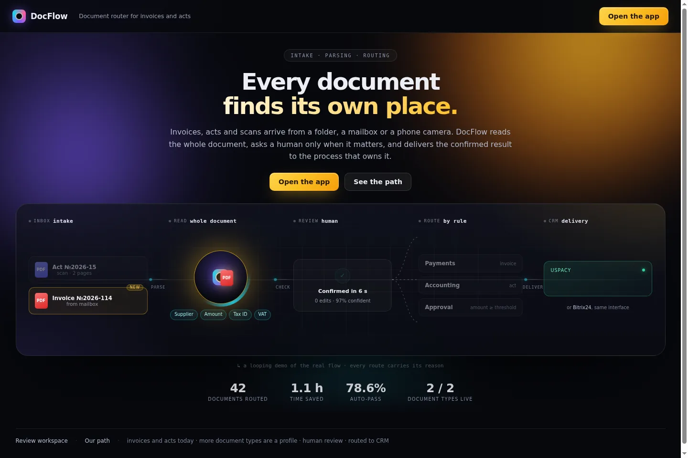
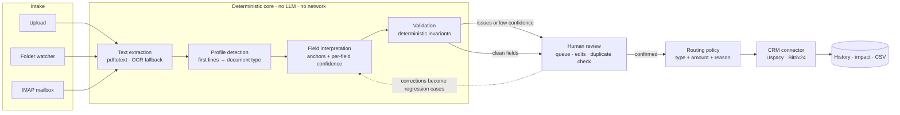

# DocFlow

**Document intake for B2B teams: a deterministic pipeline from a file or a mailbox to a reviewed CRM deal.**

DocFlow takes a PDF, a scan or an e-mail attachment, works out what kind of document
it is, reads the whole document, shows the human what it is unsure about, lets them
confirm it on one screen, and sends the result to the process that owns it — payments,
accounting or approval — creating or updating a deal in the CRM.

The core is deterministic on purpose: formal rules are code, the document is read
through a **profile** (a data description of a document type and its market), and the
only probabilistic step — deciding what a human still needs to check — is surfaced in
the review queue instead of being hidden behind a model. No LLM orchestrator sits in
the decision path; that is a design choice, explained below.



## What it does

- **Intake from several sources**: browser upload, sample documents, a watched
  `data/inbox/` folder, or an IMAP mailbox.
- **Whole-document recognition**: the first lines decide the document type through a
  profile registry (invoice, act of completed work, delivery note); the profile supplies
  the anchors, value formats and field labels the reviewer sees. `pdftotext` first, OCR
  only as a fallback for scans.
- **Deterministic validation**: amount = sum of items, VAT ≈ 20/120 of the total, tax-ID
  and IBAN formats, phone/e-mail shape. A failed invariant lowers confidence and puts the
  document in front of a human — it never "fixes" a value silently.
- **Deterministic routing**: invoice → Payments, act and delivery note → Accounting, any
  document above `DOCFLOW_APPROVAL_THRESHOLD` (default 100 000) → Approval. The
  destination and its reason are stored with the record and written into the CRM comment.
- **One CRM interface, two connectors**: Uspacy (verified against a live account) and
  Bitrix24 (incoming webhook, verified against a local fake of the REST protocol).
- **Duplicate protection on two levels**: local history (number + supplier + date) and a
  client-side match against the CRM.
- **History, impact report and CSV export**: auto-pass rate, review time, saved minutes,
  top manual corrections and tripped invariants.

## Architecture



The pipeline is fixed and testable: every stage has one responsibility and one output
shape, so a defect belongs to exactly one stage. The human is a stage, not an exception
handler: the review form shows per-field confidence and tripped invariants, and the
confirmation is the only moment a document can reach the CRM.

## Why this pipeline

- **Interpretation is separated from execution.** Reading a document is a judgement;
  validating, routing and writing to the CRM is arithmetic and rules. Mixing them makes
  both untestable.
- **The whole document is the context.** Line-by-line parsing produces confident errors:
  a number that looks like a total on its own line is usually a subtotal.
- **A confident error is worse than a gap.** A missing amount sends a document to a human;
  a wrong amount silently closes the wrong deal. The pipeline is built to prefer the first.
- **No LLM orchestrator by design.** An agent graph in the hot path would add cost,
  latency, non-reproducible outputs and a second source of confident errors, while the
  documents that actually need interpretation are already covered by profiles and a human.
  If a model is ever added, it is a fallback that proposes a value into the same review —
  never a stage that decides on its own.
- **A new document type is data, not a branch.** Profiles carry anchors, totals wording,
  value formats and labels; the parser and the CRM connectors stay unchanged. Three types
  ship today: a Ukrainian invoice, an act of completed work and a delivery note.

## Handling dirty data

The interesting engineering is not the happy path. These are the failure classes the
system is built around, and the test that keeps each one fixed.

| What goes wrong | What the system does | Proof |
| --- | --- | --- |
| OCR reads «ІПН» as «INH», «ЄДРПОУ» as «ЕДРПОУ», «№» as «N/Mo/Ne» | The profile knows OCR look-alikes in its tax-ID and number anchors; the document is read as a whole, not per line | OCR-noise fixtures in `tests/run_eval.py` |
| A scan has no text layer | Text extraction falls back to OCR with the language set of the registered profiles; nothing is guessed from the filename | `tests/run_eval.py` plus a verified image-only sample |
| Items do not add up to the total, or VAT ≠ 20/120 | The invariant fails, the confidence of the total and VAT is halved, the document is flagged with issues and waits for a human | `tests/run_eval.py` — 104 checks, 0 confident errors |
| Tax ID, IBAN, phone or e-mail is malformed | The field is marked low-confidence and reported as an issue; no value is ever silently corrected | `tests/run_eval.py`, `validation.py` |
| The same invoice arrives twice | Local history is checked first (number + supplier + date), then the CRM is matched on the client; the second confirmation returns the existing deal instead of creating a new one | `tests/test_dedupe.py` |
| The CRM ignores `search`/`filter`/`limit` and returns a page anyway | The connector reads pages and matches on the client; a `200` answer is never trusted as proof that a filter was applied | `tests/test_uspacy_match.py` |
| An old cached form posts fewer fields than the document has | Missing keys are merged back from the parsed result on the server; pages are served with `Cache-Control: no-store` | `tests/test_crm_enrichment.py` |
| Mail crashes after an attachment was ingested | The message is marked as seen only after a successful ingest; on failure it stays unseen and is retried | `tests/test_mailbox.py` |
| A file is still being copied when the watcher sees it | Files younger than two seconds are skipped, handled files are moved aside so a restart does not process them twice | `tests/test_inbox.py` |
| The CRM is unreachable | Confirmation reports `company_error` / `contact_error` instead of pretending success; failed deals go to a retry queue | `tests/test_crm_enrichment.py` |

## Stack and engineering approach

| Piece | Choice | Why |
| --- | --- | --- |
| Runtime | Python 3.12 + FastAPI, one process | small surface, easy to run and to review; a prototype should not need a cluster |
| Persistence | JSONL history + JSON snapshots | append-only audit trail, no migration ceremony, trivially inspectable |
| UI | plain HTML/CSS/JS | no build step; the reviewer sees exactly the data the server returns |
| Documents | `pdftotext`, `pypdf`, portable Tesseract OCR | text first, OCR only as fallback |
| CRM | one connector interface, two adapters | the review flow is vendor-neutral; swapping the CRM is configuration |
| Tests | deterministic suites, no network | the same document always produces the same verdict, so regressions are visible |

The application is asynchronous only where it waits: the folder watcher and the IMAP
poll run in the background (`asyncio.to_thread`); document processing itself is
sequential, so the same input cannot race itself into two deals. There is **no
orchestration framework** (no LangGraph, no CrewAI) and no multi-agent graph: the
pipeline is a fixed sequence of deterministic stages with one human checkpoint, which is
what makes the failure classes above testable.

## Seeing it work

The workspace is one screen: the document on the left, extracted fields with per-field
confidence on the right, and the review queue below it.


Run it locally in three commands:

```bash
python3 -m venv .venv && . .venv/bin/activate
pip install -r requirements.txt
./dev.sh start
```

- overview → <http://127.0.0.1:8765/>
- workspace → <http://127.0.0.1:8765/app>

Docker:

```bash
docker build -t docflow .
docker run --rm -p 8000:8000 --env-file .env -v "$PWD/data:/app/data" docflow
```

## Configuration

Everything is optional; the application starts with no CRM and no mailbox.

| Variable | Meaning |
| --- | --- |
| `HOST` / `PORT` | bind address (default `0.0.0.0:8765`) |
| `DOCFLOW_DEMO_MODE` | `1` — Confirm returns a simulated deal, the CRM is never called |
| `DOCFLOW_CRM` | `uspacy`, `bitrix24` or `none` |
| `USPACY_BASE_URL`, `USPACY_EMAIL`, `USPACY_PASSWORD` | Uspacy account |
| `BITRIX24_WEBHOOK_URL` | incoming webhook of a Bitrix24 portal |
| `DOCFLOW_APPROVAL_THRESHOLD` | amount above which a document goes to approval |
| `DOCFLOW_MANUAL_MINUTES` | manual-entry minutes used by the impact report |
| `DOCFLOW_IMAP_HOST`, `_PORT`, `_USER`, `_PASSWORD`, `_FOLDER`, `_INTERVAL`, `_SSL` | mailbox intake; empty host/user/password disables it |
| `DOCFLOW_OCR_LANGS` | OCR languages, e.g. `ukr+eng`; default is the union of the registered profiles |

Secrets live only in `.env` (git-ignored). `.env.example` documents the keys with empty values.

## Verification

The deterministic suite runs without network, credentials or a real CRM:

```bash
python3 tests/run_eval.py            # 13 labelled fixtures, 104/104 checks, 0 confident errors
python3 tests/run_eval_split.py      # real vs synthetic split
for suite in tests/test_*.py; do python3 "$suite" || exit 1; done
```

`tests/test_*.py` covers duplicate suppression, impact maths, CRM matching and company
mapping, the review queue, document-type detection, routing rules, roadmap data, the
connector layer (Bitrix24 over a local fake HTTP server) and mailbox intake (MIME parsing,
retries, dedupe, login errors — over a local fake IMAP server). CI runs the same suites
plus a Docker build on manual dispatch and on pull requests.

## Status and limits

This is a prototype for a client demonstration, not a production platform:

- three document profiles are implemented (Ukrainian invoice, act and delivery note);
  other markets need a profile each, and the review form is one fixed field set rather
  than profile-specific;
- one workspace and one configured mailbox/CRM at a time; there are no accounts, roles or
  audit yet;
- the app has no authentication of its own and is published to a private tailnet only;
- Bitrix24 works against a local fake of the REST protocol; a live portal check is pending;
- Uspacy attachment upload and a payment task are not available in the test tenant API;
- routing rules by supplier and several recipients per document are not implemented yet.

## Repository layout and documentation

```text
app.py             FastAPI orchestration, persistence, review workflow, reporting
extractor.py       text acquisition, OCR fallback, field interpretation
profiles/          document-type profiles, market facts and the detection registry
connectors/        CRM connectors behind one interface (Uspacy, Bitrix24)
routing.py         deterministic destination policy
validation.py      deterministic field invariants
uspacy*.py         Uspacy authentication, client-side matching, deal creation
templates/         showcase page (/) and review workspace (/app)
tests/             deterministic suites and labelled fixtures
docs/              architecture, process map, roadmap, plain guide
memory/            working memory: state, handoff, decision log, plain log
```

- Architecture in detail: [`docs/architecture.md`](docs/architecture.md) · process map:
  [`docs/process-map.md`](docs/process-map.md) · case-study structure:
  [`docs/case-study.md`](docs/case-study.md).
- Product path: [`docs/roadmap.json`](docs/roadmap.json) (rendered as “Our path” on the site).

---

**По-русски, коротко:** DocFlow — прототип платформы для автоматизации документооборота:
документы приходят из папки или почты, распознаются, проходят проверку человеком и уходят
в нужный процесс и CRM. Сервис задуман универсальным: всё, что относится к конкретному
рынку, живёт в профиле документа, а не в ядре; сейчас реализованы украинские счёт, акт и
видаткова накладна.
архитектура — [`docs/architecture.md`](docs/architecture.md).
