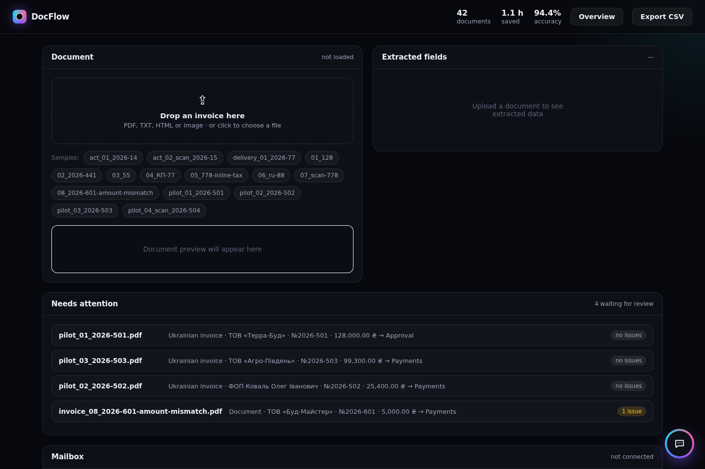
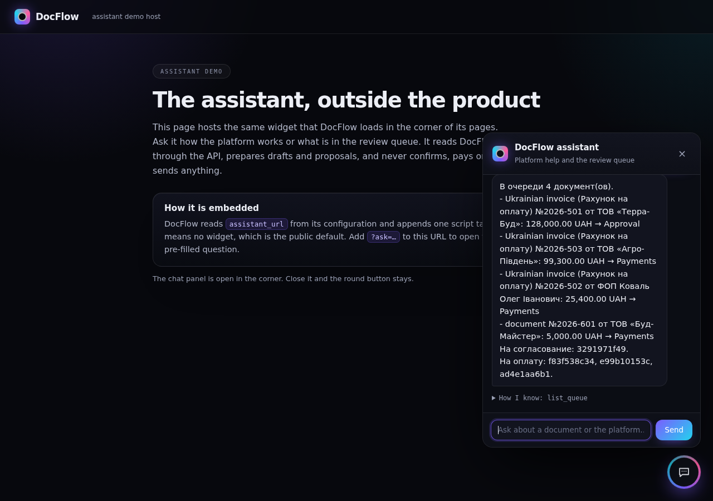
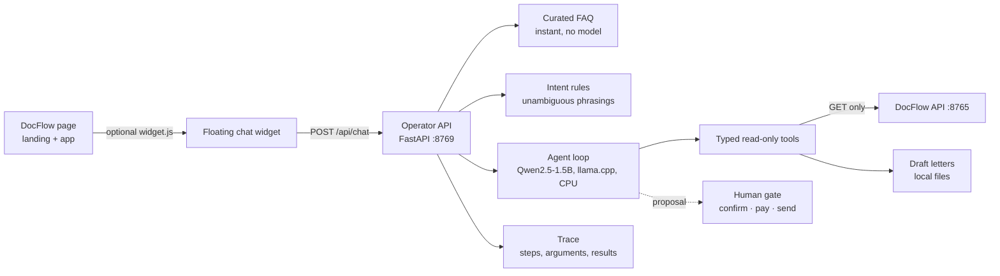

# DocFlow Operator

**The assistant part of DocFlow — same repository, its own service.**

The deployment of the whole stack (units, release, backups, healthcheck) lives in
[`../deploy`](../deploy) and is described in the [root README](../README.md); this file
covers the assistant itself.


DocFlow Operator is a small local model with a fixed set of tools, shown as a chat widget
in the corner of the DocFlow pages. A person asks in plain language — *"what is waiting
today?", "why did this invoice go to approval?", "is this a duplicate?"* — and the assistant
answers, using the real review queue and the platform's own facts. It reads DocFlow
through the same API the UI uses and can write draft letters, nothing else.

The point is not another document parser. DocFlow already extracts and routes documents
deterministically. The assistant covers the part a parser cannot: a conversation about the
work — what needs attention, why something was routed, what to do with an issue, prepare a
letter or a confirmation proposal.

Money, confirmation and sending stay human. The assistant has no code path for
`/api/confirm`, mail or deals.

Status: **works.** The model is real, the tools are real, the numbers below are measured on
this machine. 251 offline tests, 98% line and branch coverage, one command to deploy.


*The assistant button in the corner of the DocFlow review workspace.*


*A real question about the queue, answered with ids, amounts and the tool call behind it.*

## What it does

The widget sits in the bottom-right corner of both DocFlow pages. It is off by default in
the public repo: one `DOCFLOW_ASSISTANT_URL` setting turns it on for a deployment.

| Question | How the assistant answers | Time |
| --- | --- | --- |
| "How do I confirm a document?" | curated FAQ answer, no model | instant |
| "Why did this invoice go to approval?" | platform facts: routing + threshold | instant |
| "What is waiting for review?" | `list_queue` — ids, suppliers, amounts, routes | ~2–5 s |
| "Which documents need approval?" | `list_queue` — route lists | ~2–5 s |
| "Is the newest one a duplicate?" | `check_duplicate` against confirmed history | ~3–6 s |
| "Draft a payment letter for the newest document" | `draft_letter` → local file, never sent | ~4–6 s |
| "Propose confirming the newest document" | `propose_confirm` → proposal for a human | instant |
| "Show the queue and draft letters for duplicates" | model plans the steps, then a composed answer | ~20–40 s |

Every answer can be expanded with *How I know*: the tools called, their arguments and
whether they succeeded. When the model misbehaves the trace says so instead of hiding it.

## Architecture



DocFlow stays the deterministic core. The assistant is the conversational layer on top of
it, and the boundary between them is a fixed set of read-only tools.

## Design decisions

**FAQ first, model second.** Common support questions are answered from a curated knowledge
base: instant, free of hallucinations, and no CPU cost. Questions about real documents go
through tools. Only what is left reaches the model.

**Intent rules for unambiguous phrases.** A 1.5B model picks the right tool most of the
time, not every time: "propose confirming the newest document" once became a payment
letter. For phrases with one obvious intent (explain? confirm? draft? duplicate? summary?)
the tool comes from rules. Mixed requests ("check duplicates and draft letters") still go
to the model, so its planning is exercised.

**The model plans, code executes.** Seven tools with typed argument schemas; the model
cannot call anything else. Every call is validated again in Python.

**Constrained decoding.** Tool calls are JSON matching a `oneOf` schema through
llama.cpp's `response_format: json_schema`, so the output is a valid call or it is rejected
— no prose parsing.

**Answers are grounded in tool output.** For data questions the answer is composed by code
from the tool results; the model's own closing text stays in the trace as `model_answer`.
This was decided after the 1.5B model confidently listed all four documents as needing
approval when only one did. A confidently wrong answer is worse than a boring accurate one.

**Guards around a small model.** Repeated calls are refused, a read-only question stops
after one tool, a draft or proposal is always the last step, the loop is capped by steps and
a time budget, and two consecutive argument errors stop the model. A rules planner is the
fallback, so the user always gets an answer; the trace marks it.

**Warm prompt.** The system prompt is ~650 tokens; on two CPU cores that is ~40 s of
processing. The server warms the prompt cache at startup, so the first real question is as
fast as the rest.

**Widget isolation.** One script, inline styles, `dfo-` prefix, no dependency on the host
page; the host page only reads `/api/config` and loads the script if the URL is configured.

## Tools

| Tool | Arguments | What it does |
| --- | --- | --- |
| `list_queue` | `limit` | queue with ids, suppliers, amounts, routes, approval/payment lists |
| `get_document` | `doc_id` or `latest` | parsed fields, issues, confidence, route of one document |
| `check_duplicate` | `doc_id` or `latest` | compares number/supplier/date/amount against confirmed history |
| `draft_letter` | `doc_id`, `kind` | writes `data/drafts/<id>-<kind>.md`; never sends |
| `summarise` | `period` (today/week/all) | counts, totals, split by route, confirmed history |
| `propose_confirm` | `doc_id` | proposes a confirmation; a human confirms in DocFlow |
| `finish` | `answer` | ends the loop |

## Model and hardware

- `llama.cpp` build **b12418**, prebuilt `llama-b12418-bin-ubuntu-arm64`, `llama-server`
  on `127.0.0.1:8080`.
- **Qwen2.5-1.5B-Instruct Q4_K_M** (1.1 GB), CPU only, `-c 4096 -t 3`, KV cache quantised.
- Measured: **~7.7 tokens/s generation**, ~15–20 tokens/s prompt processing.
- The container looks like 8 cores and 15 GB in `nproc`/`free`, but the cgroup allows
  **2 CPU cores and 3 GB RAM**. A 3B model at 8k context was killed by the memory cap; a 3B
  Q4 model benchmarks at ~4 tokens/s and is kept on disk for accuracy comparisons only.

## Evaluation

Twelve scripted requests (`eval/scenarios.json`) run twice: through the assistant and
through a rules-only planner. The rules planner is both the baseline and the fallback.

- task success: the expected tool was called and the answer contains the expected facts;
- tool validity: no schema errors, no unknown tools, no refused repeats;
- latency measured, not estimated.

| Scenario | Answered by | Time | Result |
| --- | --- | --- | --- |
| queue overview | model | 2.6 s | ✅ |
| queue count and total | model | 3.1 s | ✅ |
| which documents need approval | intent rules | <0.1 s | ✅ |
| document details by id | model | 6.2 s | ✅ |
| duplicate check | intent rules | <0.1 s | ✅ |
| payment letter | intent rules | <0.1 s | ✅ |
| approval letter | intent rules | <0.1 s | ✅ |
| supplier reply letter | intent rules | <0.1 s | ✅ |
| confirmation proposal | intent rules | <0.1 s | ✅ |
| duplicate in the newest document | intent rules | <0.1 s | ✅ |
| queue routing | model | 4.4 s | ✅ |
| week summary | intent rules | <0.1 s | ✅ |
| **total** | **4 model · 8 rules** | **avg 1.4 s** | **12/12, 12/12 valid** |


Run it yourself (DocFlow on `:8765` and llama-server on `:8080` must be running):

```bash
.venv/bin/python eval/run_eval.py              # assistant + baseline
.venv/bin/python eval/run_eval.py --baseline   # rules only, ~0.1 s
```

Results are written to `eval/results.json`.

**How to read the result honestly.** Both columns score 12/12, but they get there
differently. On these fixed sentences the deterministic layers carry eight of twelve
answers; the model answers the other four in 2.6–6.2 s. The scripted set was written before
the FAQ and intent shortcuts existed, so it over-represents phrases a rule can recognise.
The honest next measurement is a set written *after* the shortcuts, by someone who has not
seen the patterns — that is the next evaluation step, together with a 3B comparison for the
model-answered subset (the 3B model is already on disk).

## Running it

First run: fetch the runtime once, then use the deploy script instead of two loose
terminals.

```bash
# 1. llama.cpp (prebuilt, no compilation)
curl -L -o /tmp/llama.tar.gz https://github.com/ggml-org/llama.cpp/releases/download/b12418/llama-b12418-bin-ubuntu-arm64.tar.gz
mkdir -p .tools && tar -xzf /tmp/llama.tar.gz -C .tools

# 2. model (~1.1 GB)
mkdir -p .models
curl -L -o .models/qwen2.5-1.5b-instruct-q4_k_m.gguf \
  https://huggingface.co/Qwen/Qwen2.5-1.5B-Instruct-GGUF/resolve/main/qwen2.5-1.5b-instruct-q4_k_m.gguf

# 3. python deps (runtime + the test tools)
python3 -m venv .venv && .venv/bin/pip install -r requirements-dev.txt

# 4. deploy: start what is down, wait until it answers, run the supervisor
scripts/deploy.sh deploy
```

```bash
scripts/deploy.sh status     # pids, readiness and the real /api/health
scripts/deploy.sh restart    # after a code change
scripts/deploy.sh stop
scripts/deploy.sh logs model # or operator / supervisor
```

`deploy` is idempotent: it adopts processes that are already running, starts the ones that
are not, and fails with the last log lines if a process never answers. A small supervisor
puts a dead component back up — verified by killing both processes: the operator returned in
~4 s, the model in ~9 s. The container has no systemd and no Docker daemon, so the supervisor
is a plain process: it keeps the demo alive inside the container, but after a container
restart `scripts/deploy.sh deploy` has to be run again. The first question after a cold model
start waits for the warm prompt (~40 s on two cores); `deploy` already waits for readiness
and every following question is ~2–6 s.

`DocFlow` must be reachable at `http://127.0.0.1:8765` (`DOCFLOW_URL`). To show the widget
inside DocFlow, set `DOCFLOW_ASSISTANT_URL=https://<operator-host>/widget.js` and restart
DocFlow; without it the widget is off. Model URL, step limit and time budget use the
`OPERATOR_*` environment variables.

The public surface is locked down by default, because the demo runs behind a public URL:

- `OPERATOR_CORS_ORIGINS` is empty — the widget is served by this API and talks to its own
  origin, so no cross-origin access is needed. Set it only to embed the widget on another
  domain.
- `OPERATOR_CHAT_RATE_LIMIT` (6) and `OPERATOR_CHAT_RATE_WINDOW` (60 s) cap questions per
  client address; a client over the limit gets `429` with `Retry-After`.
- `OPERATOR_CHAT_QUEUE_TIMEOUT` (20 s) is how long a question waits for the single model
  slot before it also gets `429` instead of holding the request for two minutes.
- `OPERATOR_TRACES_PUBLIC=1` exposes `/api/traces`, the file with every visitor's question;
  it answers `404` unless explicitly switched on.
- `/api/config` returns the model name and the step limit only: no internal addresses, no
  filesystem paths.

## Deploying to a real server

The demo also runs on a plain Ubuntu server (currently an Oracle Always Free ARM VM:
2 cores, 11 GB RAM, 45 GB disk). There, systemd owns the processes instead of the
`.run/` supervisor:

```bash
# once, after both repositories are on the server and the model is in .models/
sudo ../deploy/systemd/install.sh          # installs and enables the stack
systemctl status docflow-operator        # model + API + demo DocFlow
tailscale funnel --bg --https=443 http://127.0.0.1:8769   # assistant, public HTTPS
tailscale funnel --bg --https=8443 http://127.0.0.1:8765  # demo DocFlow with the widget
tailscale funnel --bg --https=10000 http://127.0.0.1:10000  # DSH web UI (optional)
```

The optional `dsh-web.service` serves the DeepSeek Harness web UI on port 10000; the
installer adds it only when `dsh` is on PATH, and derives the authority the UI
advertises from Tailscale (`DSH_PUBLIC_HOST` overrides it). Without that, a restart
would tell the browser to trust the machine's short hostname instead of the funnel
address it was opened with. On every start it writes a token URL to
`~/.dsh/logs/web.log` — that link is what grants access to an agent with shell on the
server, so keep it private and take the newest line after a restart.

The units are `../deploy/systemd/docflow.service` (web), `docflow-worker.service` (the
durable queue), `docflow-operator-model.service` and `docflow-operator.service`; paths and
the run user are configurable through `DOCFLOW_ROOT`, `ASSISTANT_ROOT` and `OWNER`. Service
output goes to the systemd journal (`journalctl -u docflow-worker`), so systemd rotates it;
the application's JSONL log and the healthcheck log are rotated by
`/etc/logrotate.d/docflow`, which the installer writes. The web unit sets
`DOCFLOW_JOBS=off`, so the queue is drained by the worker unit alone. The demo instance uses
`DOCFLOW_DEMO_MODE=1` and sample documents only — the live CRM never leaves the private
machine.

### Releasing

`sudo ../deploy/release.sh` is the release: it runs the same gate as CI (lint, the
regression baseline, and the whole suite in one pytest process with its coverage floor),
restarts `docflow` and `docflow-worker`, and
checks the pages and the API answers. If the smoke test fails, it puts the
previously released commit back and checks that too, so a bad release does not
outlive the command. `--check` runs the gate and the smoke without restarting
anything; `--rollback` returns to the recorded rollback point (the checkout ends
up detached — `git switch main` before the next release). The script refuses a
dirty tree and records every release in `docflow/.run/release/releases.log`.

### Firewall noise

SSH is key-only, but the machine is reachable from the internet, so the logs fill with
password guesses. `fail2ban` is a one-time `apt` package; the jail policy lives in
`../deploy/fail2ban/docflow.local` (five failures in ten minutes, an hour's ban) and the
installer drops it into `/etc/fail2ban/jail.d` when fail2ban is present. The whole
Tailscale range is ignored on purpose: a bad key on the laptop must not lock the owner
out of the server.

### Backups, healthcheck, rotation

Two timers come with the units:

- `docflow-backup.timer` (daily, 03:30 ± 10 min) runs `../deploy/backup/backup.sh`: a
  `pg_dump -Fc` of the database, a tarball of `data/uploads`, `data/confirmed.jsonl` and
  `data/pending`, a copy of `.env`, and SHA-256 sums — one directory per run under
  `~/backups/docflow` (mode 600), the last 14 kept. The dump is taken as the
  `docflow_backup` role (read-only, no login of its own, `BYPASSRLS`), because the working
  tables are forced under row-level security and the application role cannot read another
  tenant; `install.sh` creates and grants that role once.
- `../deploy/backup/backup.sh --check` restores the newest copy into
  `docflow_restore_check`, compares the company count and the document counters with the
  source, and drops the scratch database.
- `docflow-healthcheck.timer` (every five minutes) checks the local and public health
  endpoints, the four services and PostgreSQL. A failure goes to
  `docflow/.run/health.log` and, with `SENTRY_DSN` set, to GlitchTip as one error event —
  the same tracker application errors land in.
- With `DOCFLOW_PING_URL` set, every run also pings an external dead-man switch
  (Healthchecks.io and kin): the base URL when healthy, `/fail` when not. That is the only
  way to hear about a machine that is down — its own timer is down with it. Without the
  variable the ping is skipped and the file log remains the record.

- `docflow-offsite.timer` (daily, 04:10) runs `../deploy/backup/offsite.sh`: `restic` pushes the
  newest local bundle into an encrypted repository on Backblaze B2, keeps 14 daily and 4
  weekly snapshots, and reads a data slice back every Sunday. `--check` restores the newest
  snapshot and verifies its SHA-256 sums.

The local copy protects against a bad migration, a deleted file or a corrupted one. The
off-site repository protects against losing the machine: the B2 credentials and the
repository password live in `~/.config/docflow/backup.env` (600, never in git). Both are
needed to restore, and losing the password means losing the copy — keep them in a password
manager outside this server.

## Tests and CI

251 tests in 9 s, with no network and no model: DocFlow, llama-server and model decisions
are faked (`httpx.MockTransport` for HTTP, a scripted planner for the model). They cover the
tool catalogue and its schema, the agent loop and its failure paths, intent rules, the FAQ,
the rules baseline, the DocFlow client, configuration, the HTTP surface, the widget contract
and the evaluation scorer.

```bash
scripts/ci.sh            # ruff, pytest, coverage gate (90%, currently 98%)
scripts/ci.sh --live     # plus the live smoke: real DocFlow, real model, real /api/chat
```

`ruff`, `pytest` and coverage are configured in `pyproject.toml`. GitHub Actions
(`.github/workflows/ci.yml`) runs the same lint and coverage, then boots the API to prove it
starts without a model. The live smoke is opt-in because a CI runner has neither service.

## Honest limits

- **The FAQ is finite.** Its answers are curated; a question outside it falls back to the
  model with product facts, and the model may be vague. That is reported, not hidden.
- **The model is a router, not a writer.** It chooses tools; numbers in answers come from
  code. Long multi-step plans are out of scope.
- **CPU latency is real.** Single reads ~2–6 s, a multi-step request ~20–40 s on 2 cores.
- **No auth, no users, no conversation storage.** Traces are a local JSONL file; the demo
  is meant for a tailnet, not the open internet.
- **The rules baseline is strong on scripted tasks.** That is measured and published.
- **The supervisor is not an init system.** It survives a killed process, not a restarted
  container; there is no systemd or Docker daemon inside this environment.

## Layout

```
docflow_operator/   server, agent loop, intent rules, FAQ, tools, DocFlow client
static/widget.js    floating chat widget, no dependencies
templates/          demo page that hosts the widget
eval/               twelve scenarios, scoring, runner, results
tests/              251 offline tests plus a live smoke, marked and skipped by default
scripts/            start_model.sh, start_operator.sh, ci.sh, deploy.sh, svc.py
../deploy/systemd/   units for a real server (Oracle VM, systemd, Tailscale Funnel)
pyproject.toml      ruff, pytest and coverage configuration
```

## Docs

- Project rules: [`AGENTS.md`](AGENTS.md)
- Evaluation: [`eval/run_eval.py`](eval/run_eval.py), [`eval/scenarios.json`](eval/scenarios.json)
