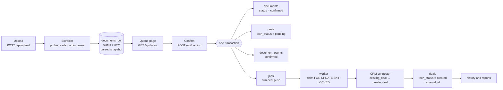

# Walkthrough: one invoice, from an upload to a CRM deal

This is the whole pipeline in one scenario, with the transaction boundaries and the failure
paths named where they happen. It is written for someone reading the code for the first
time: every step says what runs, what is committed when, and what a person sees if the step
fails. The demo instance is at <https://docflow.website> — file-based without an account,
PostgreSQL after signing in.

The scenario: a review person signs in, uploads `invoice_01_128.pdf`, checks the fields,
confirms, and the deal appears in the CRM.

## The shape of it



## Step 1 — the document arrives

`POST /api/upload` (`routes/documents.py`) streams the file to `data/uploads/` under a
character-limited id, checks the size while streaming (20 MB by default) and the extension
against the allowed set. Then `extractor.py` reads the text, `profiles/__init__.py` decides
which document profile owns the first lines, and the profile interprets the fields.

One row is inserted into `documents` with the file name, the source, the parsed fields with
per-field confidence, and `status = 'new'`. A snapshot, not a promise: the review page reads
this row, not the file, and the file is kept for the preview.

What can go wrong here: an unsupported type is refused before anything is written (400), a
file over the limit is refused while streaming (413), and a database failure leaves no row
(503) — the upload is a single insert in one transaction.

## Step 2 — a person reviews

The queue is `documents WHERE status = 'new'` for the signed-in person's company. The
isolation is a PostgreSQL policy, not a `WHERE` clause in every query: `db.tenant()` sets
`app.company_id` for the transaction, and a missing filter returns nothing rather than
another company's rows.

Opening a document sets `viewed_at` — the review session — so the reported review time is
the time a person spent, not the time the document waited.

## Step 3 — the confirmation, one transaction

`POST /api/confirm` (`pg_queue.confirm_document`) does all of this inside one transaction:

1. `SELECT ... FOR UPDATE` on the document — a second click waits and then sees the new
   status instead of confirming twice (409);
2. the fields the person submitted are merged over the parsed ones and validated: a
   contradiction in a field the person edited is refused (422), a warning is kept;
3. `documents` is updated: `status = 'confirmed'`, `confirmed_fields` (what a human
   approved), `edited_fields`, `confirmed_at`, `viewed_at` stays as the session start;
4. `routing.route()` decides the destination from the type and the amount — Payments,
   Accounting or Approval — and the reason is kept;
5. `deals` gets a row with `status = 'new'` (business status) and `tech_status = 'pending'`
   (the CRM side);
6. `document_events` records `confirmed` with the destination, the reason, the edits and the
   deal;
7. **the outbox**: `jobs` gets a `crm.deal.push` row with everything the worker needs — the
   confirmed fields, the route, the deal id.

Commit. Either all seven exist or none do.

The alternative — call the CRM in this request — was the design before: a timeout after the
commit left a confirmed deal that nobody would ever send, and a timeout before the commit
left a person unsure whether to press again. The `jobs` row is the same fact as the deal,
so the question disappears.

What can go wrong here: `403` for a viewer (the role is checked before anything); `409` for
a second confirmation; `503` when PostgreSQL is down — nothing is written, and the person
can retry.

## Step 4 — the worker sends the deal

`docflow-worker.service` runs `python -m worker`. Its claim is one statement:

```sql
UPDATE jobs SET status = 'running', attempts = attempts + 1, ...
 WHERE id = (SELECT id FROM jobs WHERE status = 'queued' AND run_after <= now()
              ORDER BY run_after, id LIMIT 1 FOR UPDATE SKIP LOCKED)
```

Two workers asking at the same instant take two different rows — `tests/test_jobs.py`
starts six of them to prove it. The attempt is counted at claim time: a worker that dies
mid-job leaves the count behind, which is the only evidence it tried.

The handler (`crm_outbox.push`) then:

1. locks the deal and sets `tech_status = 'sending'`, incrementing `attempts`;
2. in demo mode returns a simulated id (`DEMO-DB-<deal id>`) — nothing leaves the host;
3. otherwise asks the connector `existing_deal(fields)` first. This is the idempotency
   step: a previous attempt may have created the deal and lost the answer, so a retry
   adopts what the CRM already has instead of creating a second one;
4. otherwise `ensure_company` → `ensure_contact` → `create_deal`, the same connector
   interface a live Uspacy or Bitrix24 deployment uses;
5. writes the result in a short transaction: `tech_status = 'created'`,
   `external_id`, the document becomes `sent`, and `document_events` records
   `deal_created` with the external id and the attempt count.

On a failure the row keeps the reason — `tech_status = 'timeout'` when there was no answer,
`pending` for a retry, `error` once the attempts are spent — and the handler raises, so the
queue retries with backoff (15 s, then doubling, capped at an hour, five attempts by
default). A dead job writes `deal_failed`, and `/api/metrics` counts deals by status:
`error` is the number that needs a person.

A job whose worker died is returned to the queue after fifteen minutes
(`jobqueue.reap_stale`), keeping the attempt count. On the way back the retry sees
`tech_status = 'sending'` and therefore takes the "ask first" path above.

## Step 5 — what the person sees afterwards

The history (`/api/documents`) reads `confirmed_fields` and the deal's `external_id`, so a
row says what was confirmed, how many fields a person changed, how long the review took and
which deal it became. The impact report counts the same rows — the page and the report read
one source, so they cannot disagree. In the review queue the document is gone: `status` is
no longer `new`.

## The failure catalogue

| Failure | Where it is handled | What a person sees |
| --- | --- | --- |
| Unsupported file or one over the limit | `routes/documents.py` before any write | 400 / 413 with the limit |
| Two clicks on Confirm | `FOR UPDATE` and the status check | 409 "already confirmed" |
| Viewer presses Confirm | role check before the transaction | 403 |
| Database down during confirm | one transaction, rolled back | 503, nothing written, retry is safe |
| CRM times out | `tech_status = 'timeout'`, job retried | deal not in the CRM yet; metrics show `timeout` |
| Worker dies mid-call | stale lease returns the job; retry asks `existing_deal` | no duplicate deal |
| Answer lost, deal created | same "ask first" path | the existing deal is adopted |
| Attempts spent | `tech_status = 'error'`, `deal_failed` event | the deal is listed as stuck in metrics |
| Duplicate document (same supplier, number, date) | unique index on `documents` | the second upload is refused |

## Reproducing it

```bash
# the demo runs on files without an account; the database path is behind a session
curl -s http://127.0.0.1:8765/api/health
python3 -m worker --once        # drain what is ready
pytest -q tests/test_outbox.py  # the outbox checks against a real demo database
```

The end-to-end check used during development creates a throwaway company, uploads a sample,
confirms it, waits for the worker to move the deal to `created`, and deletes the company —
the same scenario this document describes.

## Where to look

| Step | File |
| --- | --- |
| Upload, confirm, files | `routes/documents.py`, `pg_queue.py` |
| Parsing and profiles | `extractor.py`, `profiles/` |
| Destination rules | `routing.py` |
| Outbox and the CRM call | `crm_outbox.py`, `connectors/` |
| Queue, retries, stale leases | `jobqueue.py`, `worker.py`, `workerkit.py` |
| What the worker knows | `tasks.py` |
| History and reports | `pg_documents.py`, `impact.py` |
